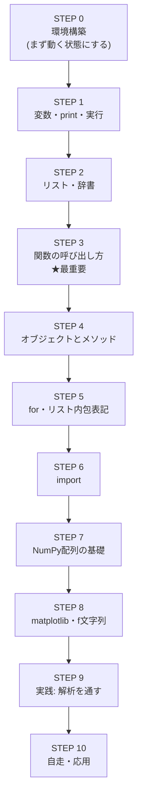
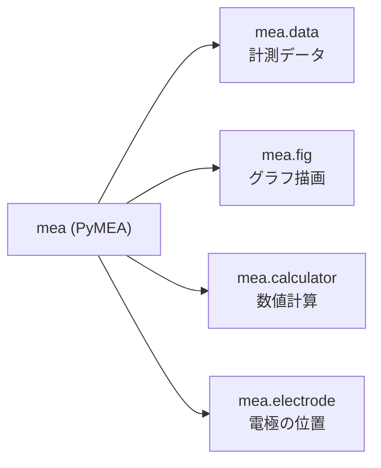

# pyMEA を使いこなすための Python 学習ロードマップ（初心者向け）

> **このドキュメントについて**
> 「MEA の解析を pyMEA でやりたいけれど、プログラミングは初めて。まず何から手をつければいいの？」という方のための学習の道しるべです。
> Python の膨大な文法をすべて覚える必要はありません。**pyMEA で研究解析を不自由なく行うために本当に必要な範囲**だけを、順番に、無理なく習得できるように並べました。
> 各ステップには「何を学ぶか」「なぜ pyMEA で必要か（実際のコード例つき）」「到達目標」を書いてあります。上から順に進めてください。

---

## 目次

- [はじめに：このロードマップの歩き方](#はじめに-このロードマップの歩き方)
- [全体像（学習マップ）](#全体像-学習マップ)
- [STEP 0. 環境をつくる（解析を始める準備）](#step-0-環境をつくる-解析を始める準備)
- [STEP 1. Python を動かしてみる（変数・print・実行方法）](#step-1-python-を動かしてみる-変数printの実行方法)
- [STEP 2. データのまとまりを扱う（リスト・タプル・辞書）](#step-2-データのまとまりを扱う-リストタプル辞書)
- [STEP 3. 関数を呼び出す（位置引数とキーワード引数）](#step-3-関数を呼び出す-位置引数とキーワード引数)
- [STEP 4. オブジェクトとメソッド（`mea.fig.showAll()` の読み方）](#step-4-オブジェクトとメソッド-meafigshowall-の読み方)
- [STEP 5. くり返し処理（for ループとリスト内包表記）](#step-5-くり返し処理-for-ループとリスト内包表記)
- [STEP 6. import の仕組み（ライブラリを読み込む）](#step-6-import-の仕組み-ライブラリを読み込む)
- [STEP 7. NumPy 配列の基礎（インデックスとスライス）](#step-7-numpy-配列の基礎-インデックスとスライス)
- [STEP 8. グラフと結果の出力（matplotlib と f 文字列）](#step-8-グラフと結果の出力-matplotlib-と-f-文字列)
- [STEP 9. 実践：最初の解析を最後まで通す](#step-9-実践-最初の解析を最後まで通す)
- [STEP 10. 自走できるようになる（応用と困ったときの調べ方）](#step-10-自走できるようになる-応用と困ったときの調べ方)
- [よくあるつまずきどころ](#よくあるつまずきどころ)
- [学習リソース集](#学習リソース集)
- [関連ドキュメント](#関連ドキュメント)

---

## はじめに：このロードマップの歩き方

- **完璧を目指さないでください。** pyMEA を使うのに、クラスの自作やアルゴリズムの実装は不要です。必要なのは「用意された関数を正しく呼び出す」ための最小限の文法です。
- **手を動かしながら進めてください。** 読むだけでは身につきません。各 STEP のコードは、実際に自分のパソコンで打ち込んで実行しましょう。
- **1 日 30 分でも構いません。** STEP 1〜8 はそれぞれ 30 分〜数時間で読めます。合計しても、実データ解析にたどり着くまで数日〜2 週間ほどが目安です。
- **迷ったら STEP 9 を先に眺めてください。** 「最終的にどんなコードを書くのか」を先に見ると、途中の文法が「何のために必要か」がわかりやすくなります。

> 💡 このロードマップは **Python の言語そのものの入門** です。pyMEA の機能一覧・使い方そのものは [`README_ja.md`](../README_ja.md) と [使い方スライド](./pyMEA_code_guide_slides.md) にまとまっています。両方を行き来しながら進めるのがおすすめです。

---

## 全体像（学習マップ）



**特に重要なのは STEP 3（関数の呼び出し方）と STEP 4（オブジェクトとメソッド）です。** pyMEA のコードは、その大半が「関数・メソッドを引数を指定して呼び出す」だけで成り立っています。ここを押さえれば一気に読めるようになります。

---

## STEP 0. 環境をつくる（解析を始める準備）

**学ぶこと**：Python が動く環境と pyMEA をパソコンに用意します。

まずは「コードを実行できる状態」を作ります。方法は 2 つあります。初心者には **A（Dev Container）** が最もつまずきにくくおすすめです。

| 方法 | 向いている人 | 参照ドキュメント |
|---|---|---|
| **A. Dev Container（推奨）** | 環境構築で悩みたくない人。VS Code を使う人 | [Dev Container 環境構築ガイド](./setup/devcontainer_guide.md) |
| **B. 自分の PC に直接インストール** | すでに Python が入っている人 | [`README_ja.md` の「環境構築」](../README_ja.md#環境構築) |

方法 B の場合、Python 3.12 をインストールしたうえで、次のコマンドで pyMEA を導入します。

```bash
pip install git+https://github.com/kkito0726/MEA_modules.git
```

**到達目標**：次の 2 行を実行してエラーが出なければ、環境構築は成功です（まだ意味がわからなくて大丈夫）。

```python
from pyMEA import read_MEA
print("pyMEA を読み込めました！")
```

> 💡 **コードはどこに書くの？** 研究解析では **Jupyter Notebook**（拡張子 `.ipynb`）を使うのが便利です。グラフをその場で表示でき、1 行ずつ試しながら進められます。Dev Container を使えば最初から用意されています。

---

## STEP 1. Python を動かしてみる（変数・print・実行方法）

**学ぶこと**：変数への代入、`print()` での表示、コメント（`#`）、数値と文字列の違い。

```python
# これはコメント。# 以降はプログラムとして実行されません

start = 0          # 数値（整数）を変数 start に入れる
end = 5            # 数値
message = "解析開始"  # 文字列（"..." で囲む）

print(start)       # 0 と表示される
print(message)     # 解析開始 と表示される
```

**なぜ pyMEA で必要か**：pyMEA のコードは「設定値を変数に入れて、関数に渡す」の繰り返しです。実際のサンプル（[`isi_example.py`](../isi_example.py)）でも冒頭で設定値を変数にまとめています。

```python
HEDFILE_PATH = "path/to/your_file.hed"  # 文字列（ファイルの場所）
ELECTRODE_DISTANCE = 450                # 数値（電極間距離 μm）
START = 0                               # 数値（開始時刻 s）
END = 5                                 # 数値（終了時刻 s）
CH = 6                                  # 数値（対象チャンネル番号）
```

> 💡 **多重代入**もよく出てきます。`start, end = 0, 30` は「`start` に 0、`end` に 30 を同時に入れる」という意味です。

**到達目標**：変数に数値・文字列を入れ、`print()` で表示できる。`#` でコメントを書ける。

---

## STEP 2. データのまとまりを扱う（リスト・タプル・辞書）

**学ぶこと**：リスト `[ ]`、タプル `( )`、辞書 `{ }` の基本と、そこから値を取り出す方法。

```python
eles = [1, 2, 3, 4, 5]   # リスト：複数の値を順番に並べたもの
print(eles[0])           # 0 番目 → 1（番号は 0 から始まる点に注意！）

volt_range = (-300, 300) # タプル：後から変更しない値の組
```

**なぜ pyMEA で必要か**：描画したい電極番号を **リスト** で渡す場面が頻繁にあります。

```python
eles = [1, 2, 3, 4, 5]                 # 描画したい電極をリストに格納
mea.fig.showDetection(eles=eles, start=0, end=1)
mea.fig.raster_plot(peak_index=peak_index, eles=eles, start=0, end=1)
```

また、ピーク検出の結果は **「電極番号 → その電極のピーク」という辞書のような形** で返ってきます。`[ ]` に電極番号を入れて取り出します。

```python
peak_index_neg = detect_peak_neg(mea.data)
peak_index_neg[5]   # ch 5 のピーク位置を取り出す
```

**到達目標**：リストを作り、`[番号]` で要素を取り出せる。「番号は 0 から始まる」ことを理解している。

---

## STEP 3. 関数を呼び出す（位置引数とキーワード引数）★最重要

**学ぶこと**：関数の呼び出し方、**位置引数**と**キーワード引数**（名前付き引数）、デフォルト引数、戻り値を変数で受け取ること。

これは **pyMEA を使ううえで最も重要な STEP** です。ここさえ理解すれば、pyMEA のコードの 8 割は読めます。

```python
# 位置引数：書いた順番で渡す
mea = read_MEA(hed_path, start, end, electrode_distance)

# キーワード引数：名前を指定して渡す（順番を気にしなくてよい・意味がわかりやすい）
mea = read_MEA(hed_path, start=0, end=5, electrode_distance=450)

# 戻り値を変数 mea で受け取っている
```

pyMEA の関数には**デフォルト値**が設定された引数が多く、**指定しなければ既定値が使われます**。だから最初は少ない引数だけ渡せば動きます。

```python
# threshold は指定しなければ既定値 3 が使われる
peak_index_neg = detect_peak_neg(mea.data)

# 必要な引数だけ名前を指定して上書きできる
peak_index_pos = detect_peak_pos(mea.data, threshold=2)
```

**なぜ pyMEA で必要か**：pyMEA のドキュメントは関数の「シグネチャ（引数一覧）」で書かれています。これを読めれば、どんな引数を渡せるか自分で判断できます。例：

```python
def read_MEA(
    hed_path: str,               # .hed ファイルのパス（文字列）
    start: int,                  # 読み込み開始時間 (s)
    end: int,                    # 読み込み終了時間 (s)
    electrode_distance: int,     # 電極間距離 (μm)
    filter_type=FilterType.NONE, # = があるものはデフォルト値つき（省略可）
) -> PyMEA:                      # -> は「戻り値の型」
```

> 💡 `引数名=値` の形（`start=0`）を**キーワード引数**、`= 値` がついた定義（`filter_type=FilterType.NONE`）を**デフォルト引数**と呼びます。この 2 つを区別できると、ドキュメントがぐっと読みやすくなります。

**到達目標**：位置引数とキーワード引数の違いを説明できる。「`=` つきの引数は省略できる」とわかる。戻り値を変数で受け取れる。

---

## STEP 4. オブジェクトとメソッド（`mea.fig.showAll()` の読み方）

**学ぶこと**：オブジェクトの「属性（`.data` など）」と「メソッド（`.showAll()` など）」、ドット `.` でたどる書き方、メソッドチェーン。

`read_MEA()` が返す `mea` は、中に 4 つの担当役（部品）を持っています。**ドット `.` でその部品にアクセスし、さらにその部品のメソッドを呼びます。**



```python
mea.data                       # 計測データ本体（MEA）
mea.data.SAMPLING_RATE         # 属性：サンプリングレートという「値」を取り出す
mea.fig.showAll(0, 1)          # メソッド：fig（描画担当）に「64電極を描いて」と命令する
mea.calculator.isi(peak_index, ch=2)  # メソッド：calculator に「ISI を計算して」と命令する
```

- **属性**：`.` の後ろに `()` がない → 中に入っている「値」を取り出す（例：`mea.data.SAMPLING_RATE`）
- **メソッド**：`.` の後ろに `()` がある → 「何かをして」という命令（例：`mea.fig.showAll()`）

**メソッドチェーン**：メソッドの結果に対して、さらにメソッドをつなげて呼ぶこともできます。

```python
# 「ハイパスフィルタをかけた結果」に、さらに「共通ノイズ除去」をかける
denoised = mea.data.highpass(cutoff=1).common_median_reference()
```

**なぜ pyMEA で必要か**：pyMEA の操作はほぼすべて `mea.○○.△△(...)` の形です。この読み方に慣れることが、ライブラリを使いこなす鍵になります。

**到達目標**：`mea.fig.showAll()` を「mea の中の fig（描画担当）の showAll というメソッドを呼んでいる」と読める。属性とメソッドの見分けがつく。

---

## STEP 5. くり返し処理（for ループとリスト内包表記）

**学ぶこと**：`for` によるくり返し、`range()`、そして Python らしい書き方「リスト内包表記」。

```python
# 基本の for ループ
for i in range(3):
    print(i)          # 0, 1, 2 と順に表示

# リスト内包表記：「リストを一気に作る」書き方
squares = [i * i for i in range(5)]   # [0, 1, 4, 9, 16]
```

**なぜ pyMEA で必要か**：拍動ごとに波形を切り出したり、動画のコマ（フレーム）をまとめて作ったりするときに、リスト内包表記が使われます。

```python
# 拍動ごとに波形を切り出して、時刻を 0 始まりにそろえたリストを作る
mea_list = [
    mea.from_slice(index - before_frame, index + after_frame).init_time()
    for index in peak_index_neg[ch]
]

# 重ね描き：作ったリストを for でめくって 1 枚に描く
for m in mea_list:
    plt.plot(m.data[0], m.data[ch])
```

最初は「リスト内包表記 = for ループでリストを作る短い書き方」と理解すれば十分です。難しければ、まず普通の `for` で書いてから短くする、で構いません。

**到達目標**：`for x in リスト:` でくり返しできる。リスト内包表記を見て「リストを作っているんだな」とわかる。

---

## STEP 6. import の仕組み（ライブラリを読み込む）

**学ぶこと**：`import` 文の 3 つの形。

```python
# ① まとめて読み込む（pyMEA が公開している機能を全部使えるようにする）
from pyMEA import *

# ② 必要なものだけ名前を指定して読み込む（何を使うか明確になる）
from pyMEA import read_MEA, detect_peak_neg

# ③ 別名（エイリアス）をつけて読み込む（matplotlib の定番）
import matplotlib.pyplot as plt
```

**なぜ pyMEA で必要か**：どのコードも必ず import から始まります。`from pyMEA import *` を書けば `read_MEA` や `detect_peak_neg`、`FilterType` などがすぐ使えるようになります。グラフを自分で細かく描きたいときは `import matplotlib.pyplot as plt` も併用します。

**到達目標**：`from pyMEA import *` の意味がわかる。`import ... as ...` で別名をつけられると知っている。

---

## STEP 7. NumPy 配列の基礎（インデックスとスライス）

**学ぶこと**：NumPy 配列とは何か、`[番号]` でのアクセス、`[開始:終了]` のスライス、便利な計算メソッド（`.mean()` など）。

pyMEA の計測データや計算結果は **NumPy 配列**という形で扱われます。リストに似ていますが、数値計算が高速で、平均などを 1 行で計算できます。

```python
# mea.data は「行 = 時間 or 各電極」の 2 次元データ
mea.data[0]     # 0 番目の行 = 時刻データ
mea.data[6]     # 6 番目の行 = ch 6 の電位データ

# 特定の位置だけ取り出す（応用）
time = mea.data[0][peak_index_neg[5]]   # ch 5 のピークが起きた時刻

# 配列の平均を計算する
isi.values.mean()   # ISI（拍動間隔）の平均を計算
```

> ⚠️ pyMEA では **`mea.data[0]` が時刻、`mea.data[1]`〜`mea.data[64]` が電極 1〜64 の電位**です。電極番号とインデックスが一致していて直感的です。

**なぜ pyMEA で必要か**：計算結果（ISI や FPD）は NumPy 配列で返るため、そこから平均・標準偏差を取り出すのに配列の操作が必要です。pyMEA は `.mean` `.std` `.se` といった便利なプロパティも用意していますが、生の配列を自分で操作できると応用が効きます。

**到達目標**：`配列[番号]` で行を取り出せる。`.mean()` で平均を計算できる。「番号は 0 から」を配列でも意識できる。

---

## STEP 8. グラフと結果の出力（matplotlib と f 文字列）

**学ぶこと**：`matplotlib` での簡単なグラフ描画、`f"..."`（f 文字列）による結果の整形表示。

pyMEA の `mea.fig.○○()` を使えば定番のグラフは 1 行で描けますが、**自分好みのグラフを描きたいときは matplotlib を直接使います。**

```python
import matplotlib.pyplot as plt

plt.figure()
plt.plot(mea.data[0], mea.data[3])   # 横軸=時刻, 縦軸=ch3 の電位
plt.xlabel("Time (s)")
plt.ylabel("Voltage (μV)")
plt.show()
```

計算結果を見やすく表示するには **f 文字列**が便利です。

```python
isi = mea.calculator.isi(peak_index_neg, ch=CH)
print(f"ch{CH} 平均ISI: {isi.values.mean():.4f} s")
# → ch6 平均ISI: 0.8123 s のように表示される
```

`f"..."` の中で `{ }` に変数や式を書くと、その値が文字列に埋め込まれます。`:.4f` は「小数点以下 4 桁で表示」という書式指定です。

**到達目標**：`plt.plot()` で簡単な折れ線グラフを描ける。`f"{変数}"` で値を文章に埋め込める。

---

## STEP 9. 実践：最初の解析を最後まで通す

ここまでの知識で、**実データ 1 本を「読み込み → ピーク検出 → 計算 → 表示」まで通す**ことができます。まずは [`isi_example.py`](../isi_example.py) を写経（そのまま書き写して実行）してみましょう。

```python
from pyMEA import detect_peak_neg, read_MEA

HEDFILE_PATH = "path/to/your_file.hed"   # ← 自分のファイルパスに書き換える
ELECTRODE_DISTANCE = 450
START = 0
END = 5
CH = 6

# 1. データを読み込む
mea = read_MEA(HEDFILE_PATH, start=START, end=END, electrode_distance=ELECTRODE_DISTANCE)

# 2. 下向きピーク（拍動/発火）を検出する
peak_index_neg = detect_peak_neg(mea.data)

# 3. ISI（拍動間隔）を計算する
isi = mea.calculator.isi(peak_index_neg, ch=CH)

# 4. 結果を表示する
print(f"ch{CH} ISI: {isi.values} (s)")
print(f"ch{CH} 平均ISI: {isi.values.mean():.4f} s")
```

このコードには、STEP 1〜8 で学んだ要素が全部入っています。読み解けたら、次はグラフも足してみましょう。

```python
mea.fig.showAll(0, 1)                          # 64 電極の波形を一覧表示
mea.fig.plotPeaks(CH, peak_index_neg, start=0, end=1)   # ピークが正しく取れているか確認
```

**到達目標**：自分の計測データで、読み込み・ピーク検出・ISI 計算・グラフ表示を一通り実行できる。

> 💡 ここまで来たら、[`README_ja.md`](../README_ja.md) の各セクション（FPD、伝導速度、カラーマップ、動画作成など）を、やりたいことに応じて「つまみ食い」していけます。すべて同じ `mea.○○.△△(...)` のパターンです。

---

## STEP 10. 自走できるようになる（応用と困ったときの調べ方）

最後は「知らない機能でも、自分で調べて使えるようになる」段階です。

- **ドキュメントのシグネチャを読む**：[`README_ja.md`](../README_ja.md) や [`docs/api/`](./api/) の日本語 API リファレンスには、各関数・メソッドの引数一覧が載っています。STEP 3 で学んだ読み方で、渡せる引数を自分で判断できます。
- **エラーメッセージを読む**：エラーは「怒られている」のではなく「どこで何が起きたか」を教えてくれます。最後の行（例：`FileNotFoundError`）をまず読みましょう。→ [よくあるつまずきどころ](#よくあるつまずきどころ)
- **Claude Code のコード生成スキルを使う**：本リポジトリには pyMEA 専用のコード生成スキル `/pyMEA-codegen` があります。「ch6 の ISI を計算してグラフ表示して」のように日本語で頼むだけで、pyMEA のコードを自動生成できます。詳細は [`README_ja.md` の「Claude Code スキル」](../README_ja.md#claude-code-スキル)。
- **大量ファイルの前処理**：解析前に計測ファイルをまとめて軽量な `.npz` に変換したいときは、Python 不要の CLI ツール **mea2npz** が便利です。→ [かんたんマニュアル](./mea2npz_manual.md)

**到達目標**：新しい機能を、ドキュメントを読んで自力で試せる。エラーが出ても落ち着いて原因を探せる。

---

## よくあるつまずきどころ

| 症状・エラー | よくある原因 | 対処 |
|---|---|---|
| `ModuleNotFoundError: No module named 'pyMEA'` | pyMEA がインストールされていない / 別の Python 環境で実行している | STEP 0 のインストールを再確認。Dev Container 内で実行しているか確認 |
| `FileNotFoundError` | `.hed` ファイルのパスが間違っている | パスの綴り・場所を確認。Windows は `\` を `/` に置き換えると安全 |
| `SyntaxError` | 全角スペース、閉じ忘れの `)` `]` `"`、`:` の付け忘れ | エラー行の前後を確認。全角文字が紛れていないか見る |
| `IndentationError` | インデント（行頭の空白）がずれている | `for` や `def` の中は半角スペース 4 つでそろえる |
| `IndexError` / 電極番号がずれる | 「番号は 0 から」を忘れ、電極 1 を `[0]` で取ろうとした | pyMEA では `mea.data[1]` が電極 1。時刻は `mea.data[0]` |
| グラフが表示されない | `.py` で実行している / `plt.show()` を書いていない | Jupyter Notebook で実行するのが簡単。matplotlib は `plt.show()` を呼ぶ |

---

## 学習リソース集

Python そのものの入門は、以下のような無料の定番教材が役立ちます（この順で触れるのがおすすめ）。

| 範囲 | 内容 | 参考リソース |
|---|---|---|
| Python 全般 | 変数・関数・リスト・for など基礎文法 | [Python 公式チュートリアル（日本語）](https://docs.python.org/ja/3/tutorial/) |
| NumPy | 配列・インデックス・スライス | [NumPy: the absolute basics for beginners（英語）](https://numpy.org/doc/stable/user/absolute_beginners.html) |
| matplotlib | グラフの描き方 | [Matplotlib チュートリアル（英語）](https://matplotlib.org/stable/tutorials/index.html) |

> 💡 まずは STEP 1〜8 に対応する範囲だけをつまみ食いすれば十分です。教材を「1 冊やり切る」ことを目標にすると挫折しやすいので、**pyMEA で必要になった文法をその都度調べる**スタイルをおすすめします。

---

## 関連ドキュメント

- [`README_ja.md`](../README_ja.md) — pyMEA の全機能と使い方（このロードマップを終えたら辞書代わりに使う）
- [使い方スライド](./pyMEA_code_guide_slides.md) — pyMEA の使い方をスライド形式で（コピペで動く基本パターン集）
- [Dev Container 環境構築ガイド](./setup/devcontainer_guide.md) — STEP 0 の詳細版
- [API リファレンス（日本語）](./api/) — 各クラス・メソッドの引数の詳細
- [mea2npz かんたんマニュアル](./mea2npz_manual.md) — 計測ファイルをまとめて `.npz` に変換する CLI ツール
- [`isi_example.py`](../isi_example.py) — 最小の解析サンプルスクリプト
